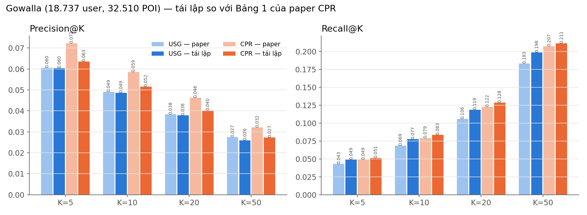

# Tái lập paper CPR — Contextualized POI Recommendation (IJCAI 2020)

**Paper:** Peng Han, Zhongxiao Li, Yong Liu, Peilin Zhao, Jing Li, Hao Wang, Shuo Shang. *Contextualized Point-of-Interest Recommendation.* IJCAI 2020, tr. 2484–2490.

| Tài nguyên | Link |
|---|---|
| Paper (IJCAI) | https://www.ijcai.org/proceedings/2020/344 |
| PDF (trong repo RSPapers) | https://github.com/hongleizhang/RSPapers/blob/master/06-POI_RS/2020-Contextualized%20Point-of-Interest%20Recommendation-IJCAI.pdf |
| Bản PDF + text đã tải | `paper/CPR_IJCAI2020.pdf`, `paper/CPR_text.txt`, `paper/VLDB2017_benchmark_Liu.pdf` |
| Dữ liệu (công khai) | https://snap.stanford.edu/data/loc-gowalla.html |
| Benchmark gốc của giao thức đánh giá | Liu et al., VLDB 2017 — http://www.vldb.org/pvldb/vol10/p1010-liu.pdf |

> **Khác với bản tái lập USG:** paper này dùng **dữ liệu công khai** (Gowalla của SNAP) và có **bảng số cụ thể**, nên có thể so sánh **trực tiếp con số**. Ngoài CPR, tôi chạy thêm USG (SIGIR 2011, code nằm sẵn trong `src/baselines/`) trên cùng dữ liệu và cách chia, để đối chiếu với dòng USG trong Bảng 1 của paper.

---

## 1. Ý tưởng

Mọi phương pháp gợi ý POI đều ngầm dựa trên một giả định: **user giống nhau thì ghé POI giống nhau, và POI giống nhau thì được cùng user ghé**. CPR dùng giả định này một cách **tường minh**:
1. Dựng **đồ thị user–user** và **đồ thị POI–POI** từ thông tin ngữ cảnh (giờ check-in, bạn bè, vị trí).
2. Tìm ma trận điểm **R** sao cho: R gần với lịch sử check-in **Y**, user kề nhau trên đồ thị có điểm giống nhau, POI kề nhau trên đồ thị có điểm giống nhau (**toàn cục** — Laplacian), và user cùng cụm có mẫu điểm giống nhau (**cục bộ** — group lasso).

## 2. INPUT

| Dữ liệu | Nội dung | Gowalla (sau khi lọc) |
|---|---|---|
| Check-in | (user, thời gian, vĩ độ, kinh độ, POI) | 1.278.274 check-in |
| Quan hệ bạn bè | (user, user) | 86.985 cạnh |
| Kích thước | | **18.737 user × 32.510 POI** (khớp chính xác paper) |

Tiền xử lý (`src/prepare.py`, `src/data.py`):
- **Lọc lặp đến khi ổn định:** giữ user ghé ≥ 15 POI khác nhau và POI có ≥ 10 user khác nhau. Lọc một lần không ra đúng số; lọc lặp thì khớp **chính xác** 18.737 / 32.510 / 1.278.274.
- **Chia theo thời gian cho từng user:** 70% check-in sớm nhất để train, 10% tiếp theo để tune, 20% muộn nhất để test (giao thức của VLDB 2017, xem mục 6).
- `Y_ij = 1` nếu user *i* từng ghé POI *j* trong tập train.

## 3. XỬ LÝ

### 3.1 Đồ thị user (Eq. 7, 8)
```
f_i  ∈ R^(24·n)  = số check-in của user i tại mỗi POI trong mỗi giờ của ngày
S^ST_ij = cos(f_i, f_j)                                   ← "cùng nơi, cùng giờ"
S^user  = (α_user + S^SR) ⊙ S^ST / (1 + α_user)           ← S^SR_ij = 1 nếu là bạn bè
G_user  = đồ thị k-láng-giềng-gần-nhất (k-NN) của S^user
```
### 3.2 Đồ thị POI (Eq. 9, 10)
```
g_i ∈ R^24 = số lượt ghé POI i theo giờ;  S^TE_ij = cos(g_i, g_j)       ← "cùng khung giờ"
S^GE_ij = exp(−d(i,j)² / 2σ²)                                          ← "gần nhau"
S^poi   = (α_poi + S^TE) ⊙ S^GE / (1 + α_poi);   G_poi = k-NN của S^poi
```
### 3.3 Hàm mục tiêu (Eq. 2–6)
```
L(R) = ½ [ λ1·tr(Rᵀ L_user R) + λ2·tr(R L_poi Rᵀ) + λ3·‖R − Y‖² + λ4·Σ_g Σ_j √n_g ‖R_(g),j‖ ]
         └ user giống → điểm giống ┘ └ POI giống → điểm giống ┘ └ gần dữ liệu ┘ └ group lasso theo cụm user ┘
L = I − D^(−1/2) W D^(−1/2)  (Laplacian chuẩn hoá);  cụm user lấy từ spectral clustering trên L_user
```
### 3.4 Tối ưu xen kẽ (Algorithm 1, Eq. 11–19)
```
T2 ← Y
lặp:   User step: T1 = argmin ½[λ1 tr(Rᵀ L_user R) + λ3‖R − T2‖²] + group lasso   → APG/FISTA (Eq. 15–17)
       POI step:  giải R(λ2 L_poi + λ3 I) = λ3 T1                               → Conjugate Gradient (Eq. 19)
R* = T1
```

## 4. OUTPUT
- Ma trận điểm R* (18.737 × 32.510). Với mỗi user: **top-K POI chưa ghé** có điểm cao nhất (K = 5, 10, 20, 50).
- Đánh giá: Precision@K, Recall@K trên tập test.

## 5. Cấu trúc code

```
cpr_reimpl/
├── data/                  # SNAP gốc (.gz) + data/processed/ (sau khi lọc)
├── paper/                 # PDF + text của paper
├── src/
│   ├── prepare.py         # lọc SNAP → bộ dữ liệu giống hệt paper
│   ├── data.py            # chia theo thời gian 70/10/20, ma trận Y, ground truth
│   ├── graphs.py          # đồ thị user / POI (Eq. 7–10), Laplacian, spectral clustering
│   ├── cpr.py             # hàm mục tiêu + Algorithm 1 (APG + CG, chạy theo khối trên GPU)
│   ├── evaluate.py        # P@K, R@K
│   ├── run_cpr.py         # tìm tham số trên tune → báo cáo trên test
│   ├── run_usg.py         # baseline USG trên cùng dữ liệu
│   └── baselines/         # code USG (baseline so sánh)
└── outputs/               # kết quả
```

Chạy:
```bash
python src/prepare.py        # 1 lần, khoảng 30 giây
python src/run_usg.py        # baseline USG, khoảng 10 phút
python src/run_cpr.py        # tìm tham số + test, khoảng 2 giờ (dừng giữa chừng được, chạy lại sẽ tiếp tục)
python src/run_cpr.py --test # chỉ chạy test với cấu hình tốt nhất đã lưu
```

## 6. Các điểm mơ hồ trong paper và cách xử lý

(Có tham vấn Fable 5.1 và kiểm tra trực tiếp trên dữ liệu.)

| # | Vấn đề | Cách xử lý | Lý do |
|---|---|---|---|
| 1 | Paper ghi tỉ lệ "70% train, **20% tune, 10% test**" | Dùng **70 / 10 / 20** (test 20%) theo thời gian như VLDB 2017 | Mọi baseline trong Bảng 1 được chép từ VLDB 2017 (ví dụ USG 0.0605 khớp số của VLDB), nên phải dùng đúng giao thức đó mới so được |
| 2 | Paper không nói cách lọc dữ liệu | Lọc lặp (≥ 15 POI/user, ≥ 10 user/POI) | Là cách duy nhất khớp chính xác 18.737 / 32.510 / 1.278.274 |
| 3 | Ground truth: POI user ghé lại có tính không? | Chỉ tính **POI mới** (chưa ghé trong train) | Paper (Mục 4.2) chỉ gợi ý POI chưa ghé nên không thể đoán trúng POI cũ; tính cả POI cũ sẽ làm recall giảm oan khoảng 26% |
| 4 | Giờ check-in trong SNAP là giờ UTC | Giờ địa phương ≈ UTC + round(kinh độ / 15) | Giờ UTC làm nhoè chu kỳ ngày–đêm |
| 5 | Đơn vị σ (khoảng [0,1; 10]) | **km** (khoảng cách haversine) | σ = 0,1 độ hay 10 độ đều không hợp lý cho POI trong thành phố |
| 6 | k của đồ thị k-NN không được nêu | Tìm trên tập tune: k ∈ {20, 50} | — |
| 7 | Eq. 14 có hệ số λ4/2 nhưng Eq. 17 dùng ngưỡng λ4·ω_g/τ | Dùng đúng Eq. 17 | Chỉ khác một hằng số, λ4 được tìm trên tune |
| 8 | Nút cô lập trên đồ thị (bậc 0) | Đặt hàng/cột Laplacian = 0 | D^(−1/2) không xác định tại nút cô lập |
| 9 | Tìm k-NN của S^poi trên 32.510² cặp | Chỉ xét 300 POI gần nhất về địa lý | S^poi ≤ S^GE giảm rất nhanh theo khoảng cách |
| 10 | Ma trận R dày 2,4 GB, GPU chỉ 2 GB | User step tách được theo **cột**, POI step tách được theo **hàng** → chạy từng khối trên GPU | Kết quả toán học giữ nguyên |
| 11 | Tuning set có gộp vào train khi test không? | Chọn tham số trên tune, rồi huấn luyện lại trên train + tune để test | Cách làm phổ biến; áp dụng giống nhau cho CPR và USG |

## 7. Kết quả trên tập test Gowalla (18.640 user có POI mới trong test)

Cấu hình CPR tốt nhất (chọn theo P@10 trên tập tune sau 43 lần thử, xem `outputs/cpr_tuning.csv`):
k_user = 20, α_user = 0,5, k_poi = 20, α_poi = 1,0, σ = 10 km, G = 20 cụm, λ1 = 0,5, λ2 = 0,2, λ3 = 1, λ4 = 1e-4, 3 vòng lặp.

| Phương pháp | P@5 | P@10 | P@20 | P@50 | R@5 | R@10 | R@20 | R@50 |
|---|---|---|---|---|---|---|---|---|
| USG — paper (Bảng 1) | 0.0605 | 0.0490 | 0.0384 | 0.0274 | 0.0431 | 0.0685 | 0.1059 | 0.1828 |
| **USG — tái lập** | **0.0605** | **0.0486** | **0.0379** | **0.0260** | 0.0491 | 0.0774 | 0.1187 | 0.1983 |
| CPR — paper (Bảng 1) | 0.0722 | 0.0586 | 0.0462 | 0.0322 | 0.0491 | 0.0789 | 0.1224 | 0.2073 |
| **CPR — tái lập** | **0.0635** | **0.0516** | **0.0402** | **0.0273** | **0.0514** | **0.0833** | **0.1283** | **0.2111** |



### Nhận xét
1. **Giao thức đánh giá đã khớp paper:** USG tái lập cho **P@5 = 0.0605, đúng bằng số trong paper**; P@10, P@20 lệch dưới 1,5%. Nghĩa là dữ liệu, cách chia và cách tính precision của mình giống cách paper (và VLDB 2017) dùng.
2. **CPR tốt hơn USG ở mọi chỉ số** (P@5 +5%, P@10 +6%, R@50 +6%), đúng kết luận của paper. Tuy vậy khoảng cách nhỏ hơn paper báo (paper: +19%).
3. **Precision của CPR thấp hơn paper khoảng 12%** (0.0635 so với 0.0722). **Recall thì bằng hoặc cao hơn paper**, nhưng recall của mình chỉ tính POI mới nên không so trực tiếp được.
4. **Các kết luận phụ của paper lặp lại được:**
   - λ1 tối ưu > λ2: Laplacian theo user quan trọng hơn theo POI (paper Mục 5.3).
   - λ4 (group lasso) ảnh hưởng rất nhỏ: 0 hay 1e-4 cho kết quả gần như nhau.
   - λ quá lớn làm kết quả giảm mạnh: λ2 = 3 cho P@10 chỉ 0.019 so với 0.029.

### Vì sao CPR tái lập thấp hơn paper?
Paper **không công bố code** và thiếu nhiều chi tiết. Các nguyên nhân có thể:
- **Không biết k** của đồ thị k-NN, **đơn vị σ**, cách chuyển giờ UTC sang giờ địa phương.
- **Không biết cấu hình tối ưu:** paper chỉ cho khoảng tìm kiếm, không cho giá trị cuối cùng. Mình chỉ thử 43 cấu hình.
- **Không rõ tiêu chí dừng** và số vòng lặp của Algorithm 1.
- **Mâu thuẫn tỉ lệ chia:** paper ghi 70/20/10 nhưng số baseline lại theo 70/10/20. Nếu paper thật sự chọn tham số trên tập 10% mà họ gọi là "test" thì con số của họ sẽ lạc quan hơn.

## 8. Giao diện demo

```bash
streamlit run app.py     # hoặc bấm đúp run_app.bat → http://localhost:8501
```
Lần đầu mở mất khoảng 30 giây để dựng đồ thị.

| Tab | Nội dung |
|---|---|
| 🎯 Gợi ý (Output) | Bản đồ: POI đã ghé (xám), gợi ý CPR (cam), gợi ý USG (xanh dương), POI mới user thật sự ghé (vòng xanh lá); bảng top-K kèm điểm R*, USG có gợi ý trùng không, đúng hay sai |
| 📥 Dữ liệu vào (Input) | Biểu đồ check-in theo giờ địa phương, POI hay ghé, bạn bè và trọng số trên đồ thị user |
| ⚙️ Vì sao gợi ý? (Xử lý) | Các user láng giềng trên đồ thị user; với từng POI được gợi ý: bao nhiêu user láng giềng đã ghé, bao nhiêu POI láng giềng user đã ghé; log hội tụ của Algorithm 1 |
| 📊 Kết quả thí nghiệm | Bảng so sánh với Bảng 1 của paper, toàn bộ lịch sử tìm tham số, hình so sánh |

Hình cho slide: `outputs/fig_compare.png`, `outputs/fig_tuning.png`, `outputs/app_screenshot_1.png`.
