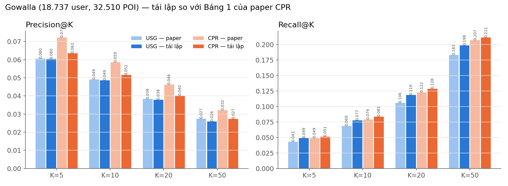

# Tóm tắt: Tái lập paper CPR — Contextualized POI Recommendation (IJCAI 2020)

**Paper:** Peng Han, Zhongxiao Li, Yong Liu, Peilin Zhao, Jing Li, Hao Wang, Shuo Shang. *Contextualized Point-of-Interest Recommendation.* IJCAI 2020, tr. 2484–2490. Paper nằm trong thư mục [06-POI_RS của RSPapers](https://github.com/hongleizhang/RSPapers/tree/master/06-POI_RS).
Link: https://www.ijcai.org/proceedings/2020/344 · PDF: `paper/CPR_IJCAI2020.pdf`

---

## 1. Bài toán

Mạng xã hội định vị (Gowalla, Foursquare…) lưu lại mỗi lần người dùng "check-in" tại một địa điểm (POI – Point of Interest). Nhiệm vụ: với mỗi người dùng, gợi ý **K địa điểm mới** (chưa từng đến) mà họ có khả năng sẽ đến nhất.

```
INPUT   : check-in (user, POI, thời gian) + toạ độ POI + quan hệ bạn bè
XỬ LÝ   : dựng đồ thị user–user, POI–POI → tối ưu ma trận điểm R (user × POI)
OUTPUT  : top-K POI chưa ghé cho mỗi user (K = 5, 10, 20, 50)
ĐÁNH GIÁ: Precision@K = số gợi ý trúng / K      Recall@K = số gợi ý trúng / số POI mới user thật sự ghé
```

## 2. Paper làm gì và áp dụng kỹ thuật gì?

**Ý tưởng:** mọi phương pháp gợi ý POI đều ngầm dựa trên giả định *"user giống nhau thì ghé POI giống nhau, và POI giống nhau thì được cùng user ghé"*. CPR dùng giả định này một cách **tường minh**: dựng 2 **đồ thị tương đồng** từ thông tin ngữ cảnh, rồi tìm **bảng điểm R** phù hợp với cả hai đồ thị.

| Thành phần | Trực giác | Kỹ thuật |
|---|---|---|
| Đồ thị user | Người đi **cùng nơi, cùng giờ** thì giống nhau; là bạn bè thì càng giống | Độ giống cosine trên vector (24 giờ × POI), **đồ thị k láng giềng gần nhất (k-NN)** |
| Đồ thị POI | Địa điểm **gần nhau** và **đông khách cùng khung giờ** thì giống nhau | **Nhân Gaussian** theo khoảng cách + cosine theo giờ, k-NN |
| Ràng buộc toàn cục | User/POI kề nhau trên đồ thị thì có điểm gần nhau | **Graph Laplacian regularization** |
| Ràng buộc cục bộ | User cùng nhóm có mẫu điểm giống nhau | **Spectral clustering** + **Group Lasso** |
| Giải bài toán | Tối ưu xen kẽ theo user và theo POI | **Accelerated Proximal Gradient (APG)** + **giải hệ tuyến tính** |

### Các công thức chính
```
Đồ thị user:  S^ST   = cos(f_i, f_j),  f_i = số check-in của user i tại mỗi POI trong mỗi giờ    (Eq. 7)
              S^user = (α_user + S^SR) ⊙ S^ST / (1 + α_user),  S^SR = 1 nếu là bạn bè          (Eq. 8)
Đồ thị POI:   S^TE   = cos(g_i, g_j),  g_i = số lượt ghé POI i theo 24 giờ                    (Eq. 9)
              S^GE   = exp(−d² / 2σ²)                               (d = khoảng cách 2 POI)
              S^poi  = (α_poi + S^TE) ⊙ S^GE / (1 + α_poi)                                   (Eq. 10)
Laplacian:    L = I − D^(−1/2) W D^(−1/2)          (W = trọng số cạnh của đồ thị k-NN)

Hàm mục tiêu (Eq. 6):
  min_R ½ [ λ1·tr(Rᵀ L_user R)                 ← user giống nhau → điểm giống nhau
          + λ2·tr(R L_poi Rᵀ)                  ← POI giống nhau → được chấm điểm giống nhau
          + λ3·‖R − Y‖²                        ← bám sát lịch sử check-in thật (Y_ij = 1 nếu đã ghé)
          + λ4·Σ_g Σ_j √n_g ‖R_(g),j‖ ]        ← group lasso theo các nhóm user

Algorithm 1 (lặp xen kẽ):
  Bước User: làm mượt R theo đồ thị user  → APG + ngưỡng mềm theo nhóm   (Eq. 15–17)
  Bước POI : giải R(λ2 L_poi + λ3 I) = λ3 T                              (Eq. 19)
  Kết quả R* = ma trận sau bước User cuối cùng
```
**Trực giác:** điểm số được **lan truyền** từ những nơi bạn đã đến sang những user giống bạn và những POI giống các nơi đó.

## 3. Đã dựng lại như thế nào?

| Bước | Làm gì | File |
|---|---|---|
| 1. Dữ liệu | Tải **Gowalla gốc từ SNAP** (công khai, 6,4 triệu check-in). **Lọc lặp** đến khi ổn định (user ≥ 15 POI, POI ≥ 10 user) → **18.737 user, 32.510 POI, 1.278.274 check-in: khớp chính xác với paper** | `src/prepare.py` |
| 2. Chia dữ liệu | Theo **thời gian** cho từng user: 70% check-in sớm nhất train, 10% tiếp theo tune, 20% muộn nhất test (giao thức benchmark VLDB 2017 mà paper dùng) | `src/data.py` |
| 3. Đồ thị | Đồ thị user và POI (Eq. 7–10), Laplacian chuẩn hoá, spectral clustering | `src/graphs.py` |
| 4. Mô hình | Hàm mục tiêu Eq. 6 + Algorithm 1. Ma trận R nặng 2,4 GB, lớn hơn GPU 2 GB → tách **bước User theo cột**, **bước POI theo hàng**, chạy từng khối trên GPU (kết quả toán học không đổi) | `src/cpr.py` |
| 5. Tìm tham số | Tìm theo từng giai đoạn trên tập **tune**, **43 cấu hình**, chọn theo P@10. Tốt nhất: k_user = k_poi = 20, σ = 10 km, λ1 = 0,5, λ2 = 0,2, λ3 = 1, λ4 = 1e-4, G = 20 cụm, 3 vòng lặp | `src/run_cpr.py` |
| 6. Baseline | Chạy **USG** (SIGIR 2011, có trong bảng của paper) trên cùng dữ liệu và cách chia để **kiểm chứng giao thức đánh giá** | `src/run_usg.py`, `src/baselines/` |
| 7. Giao diện | Web app: bản đồ so sánh gợi ý CPR và USG, giải thích vì sao một POI được gợi ý | `app.py` |

### Các điểm mơ hồ trong paper và cách xử lý (có tham vấn Fable 5.1)

| Vấn đề | Cách xử lý |
|---|---|
| Paper ghi tỉ lệ "70% train / **20% tune / 10% test**", nhưng các số baseline trong bảng lấy từ VLDB 2017 với **70/10/20** | Dùng **70/10/20**. USG khớp 0.0605 xác nhận lựa chọn này đúng |
| Paper không nói cách lọc dữ liệu | Lọc lặp: cách duy nhất khớp chính xác số user/POI/check-in |
| SNAP lưu giờ **UTC** | Quy đổi sang giờ địa phương ≈ UTC + round(kinh độ / 15) |
| Đơn vị của σ (khoảng [0,1; 10]) | **km** (khoảng cách haversine) |
| k của đồ thị k-NN không được nêu | Tìm trên tập tune: k ∈ {20, 50} |
| Ground truth có tính POI user ghé lại không? | Chỉ tính **POI mới**, vì paper chỉ gợi ý POI chưa ghé |
| Nút cô lập trên đồ thị | Đặt hàng/cột Laplacian bằng 0 |

## 4. Bảng so sánh: Paper và bản dựng lại

Cùng dữ liệu Gowalla, cùng cách chia, tập test có 18.640 user.

| Phương pháp | P@5 | P@10 | P@20 | P@50 | R@5 | R@10 | R@20 | R@50 |
|---|---|---|---|---|---|---|---|---|
| USG — paper | 0.0605 | 0.0490 | 0.0384 | 0.0274 | 0.0431 | 0.0685 | 0.1059 | 0.1828 |
| **USG — dựng lại** | **0.0605** | **0.0486** | **0.0379** | **0.0260** | 0.0491 | 0.0774 | 0.1187 | 0.1983 |
| *Chênh lệch* | *0%* | *−0,8%* | *−1,3%* | *−5%* | *+14%* | *+13%* | *+12%* | *+8%* |
| CPR — paper | 0.0722 | 0.0586 | 0.0462 | 0.0322 | 0.0491 | 0.0789 | 0.1224 | 0.2073 |
| **CPR — dựng lại** | **0.0635** | **0.0516** | **0.0402** | **0.0273** | **0.0514** | **0.0833** | **0.1283** | **0.2111** |
| *Chênh lệch* | *−12%* | *−12%* | *−13%* | *−15%* | *+5%* | *+6%* | *+5%* | *+2%* |



| Kết luận của paper | Bản dựng lại | Khớp? |
|---|---|---|
| CPR tốt hơn USG | CPR hơn USG ở **mọi** chỉ số (P@5: +5%) | ✅ (khoảng cách nhỏ hơn paper: +19%) |
| λ1 tối ưu > λ2 (đồ thị user quan trọng hơn đồ thị POI) | λ1 = 0,5 > λ2 = 0,2 | ✅ |
| λ4 (group lasso) ảnh hưởng rất ít | λ4 = 0 và 1e-4 cho P@10 gần như bằng nhau | ✅ |
| λ quá lớn làm giảm hiệu quả | λ2 = 3 → P@10 giảm từ 0,029 xuống 0,019 | ✅ |

## 5. Kết luận

1. **Dữ liệu và giao thức đánh giá khớp paper.**
   - Lọc ra đúng 18.737 user / 32.510 POI / 1.278.274 check-in.
   - Baseline USG dựng lại cho **P@5 = 0.0605, trùng khớp tuyệt đối** với paper; P@10 và P@20 lệch dưới 1,5%.
2. **CPR dựng lại tốt hơn USG ở mọi chỉ số**, và các kết luận về tham số của paper đều lặp lại được (λ1 > λ2, λ4 ít tác dụng, λ quá lớn thì giảm hiệu quả).
3. **Precision của CPR thấp hơn paper khoảng 12%.** Recall bằng hoặc cao hơn paper, nhưng recall của mình chỉ tính POI mới nên không so thẳng được (USG cũng lệch +8% đến +14% về recall dù precision khớp).
4. **Nguyên nhân chênh lệch precision:**
   - Paper **không công bố code và cấu hình tối ưu**, chỉ cho khoảng tìm kiếm.
   - Thiếu chi tiết: k của đồ thị, đơn vị σ, cách xử lý giờ, tiêu chí dừng.
   - Mô tả tỉ lệ chia dữ liệu mâu thuẫn.
   - Ngân sách tìm tham số của mình có hạn (43 cấu hình).
5. **Bài học:**
   - Khi tái lập paper, cần **kiểm chứng giao thức bằng một baseline đã biết số** (ở đây là USG = 0.0605) trước khi so mô hình chính.
   - Chỉ so sánh các phương pháp trên **cùng dữ liệu, cùng cách chia**.

---

**Chạy lại:** `python src/prepare.py` → `python src/run_usg.py` → `python src/run_cpr.py` → bấm đúp `run_app.bat`. Chi tiết ở `README.md`.
**Hình cho slide:** `outputs/fig_compare.png`, `outputs/fig_tuning.png`, `outputs/app_screenshot_1.png`.
